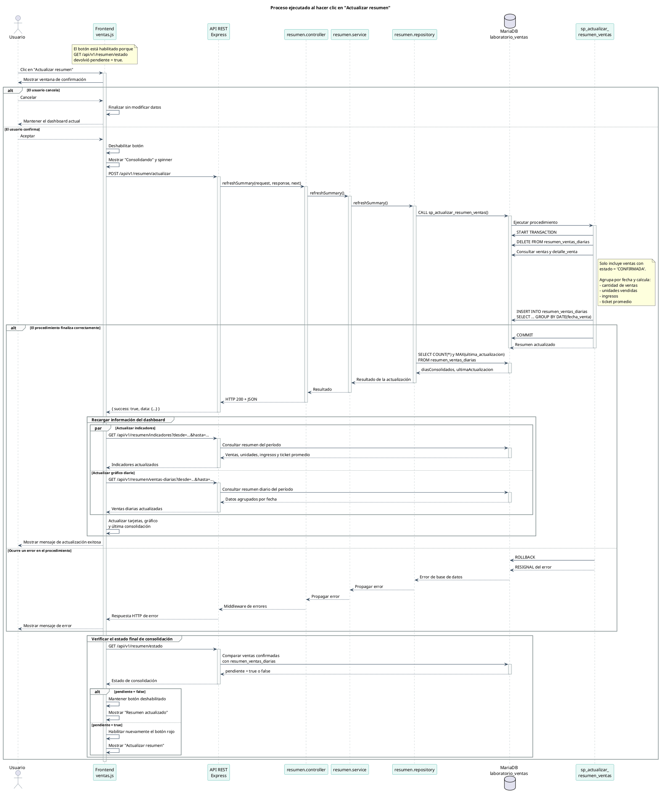

# Diagrama PlantUML del proceso **Actualizar resumen**

El siguiente diagrama de secuencia representa el proceso ejecutado cuando el usuario hace clic en el botón **Actualizar resumen**. Incluye la confirmación, la llamada al endpoint, la ejecución del procedimiento almacenado, la recarga del dashboard y el manejo de errores.

## Resumen del flujo

1. El frontend solicita confirmación al usuario.
2. Si el usuario acepta, envía `POST /api/v1/resumen/actualizar`.
3. El backend ejecuta `CALL sp_actualizar_resumen_ventas()`.
4. El procedimiento reconstruye `resumen_ventas_diarias` usando únicamente ventas confirmadas.
5. Si la operación tiene éxito, el frontend vuelve a consultar los indicadores y las ventas diarias.
6. Finalmente, consulta `GET /api/v1/resumen/estado` para habilitar o deshabilitar el botón según existan cambios pendientes.
